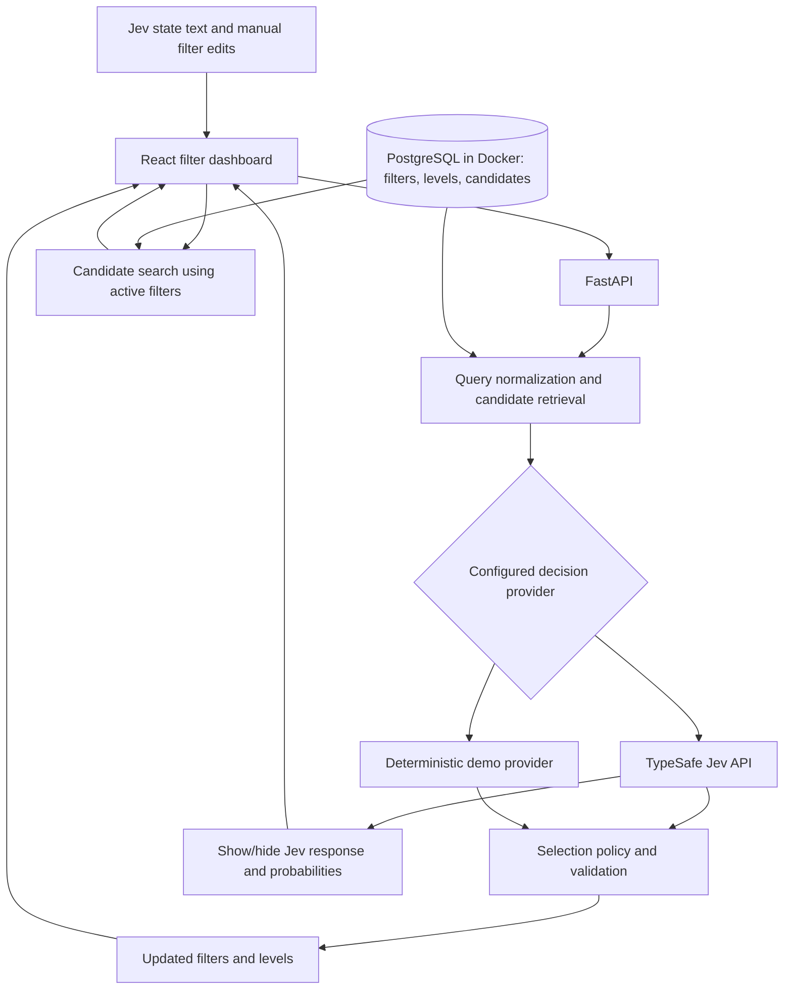

# Smart Filter Selector with Jev

Planning baseline: 4 November 2026. This document describes the intended rebuild; it does not indicate that the application has been implemented.

## 1. The idea behind the project

Smart Filter Selector turns a natural-language staffing or engineering requirement into a structured, editable set of search filters. It then uses those filters to find relevant profiles and show where each profile fits or falls short.

An engineering catalog can contain hundreds of tools, domains, competencies, specialties, and proficiency levels. Someone searching for an expert usually knows the work they need done, but may not know the catalog terminology or which combination of filters captures that work. Manually selecting every filter is slow and can miss relevant profiles. Broad keyword matching can also introduce loosely related results.

The application bridges that gap through a filter-first dashboard. Users see the list of filters and their applicable levels, with the candidate list at the bottom of the same page. A text field contains the state sent to Jev. Submitting that state lets Jev update the filters and levels; users can also change them manually. The candidate list refreshes from the active filters. A show/hide panel exposes Jev's response and all returned probabilistic values for inspection.

Example input:

> Find a senior railway signalling engineer with ERTMS and DOORS experience, English B2 or higher, excluding metro projects.

The intended interpretation is a set of domain and skill requirements, a seniority requirement, an English proficiency minimum, and a context exclusion. The exact catalog IDs and profile matches come from seeded data. Experience with DOORS must not imply a tool-expertise level unless the query supports one. Railway knowledge must not automatically imply ERTMS expertise. English B2 must be attached to English rather than treated as a global language level.

The product's value is an auditable transition from user intent to catalog filters to profile matches. Users retain control over the search; Jev supplies structured judgments within constraints defined by application code.

## 2. Intended users and first-release boundaries

Primary users are recruiters, engineering staffing coordinators, project managers, and technical leads searching for people with specific engineering capabilities.

The first release centers on one dashboard: a Jev state text field, editable filters with level controls, a collapsible Jev response panel, and candidate results at the bottom. Supporting features include candidate details, catalog inspection, saved searches, and analysis history. Mock data and example scenarios will be based on examples the user supplies later; their volume and detailed structure are not fixed yet.

Profile matching is an extension of the legacy filter-selection service, proposed to demonstrate the complete workflow. It is kept in a separate module so the filter API remains independently usable.

Automatic hiring decisions, CV ingestion, applicant tracking integrations, authentication, multi-tenant access, and hosted deployment are later work. PostgreSQL in Docker is part of the initial architecture. Candidate data for the demonstration will follow the user's forthcoming examples; introducing real personal data would require a separate access and retention design.

## 3. What we learned from the legacy project

The original project contained a Flask backend and engineering filter datasets, with no frontend. Its selection pipeline used translation, embedding retrieval, LLM refinement, and LLM-based expertise-level detection. Query examples cover English, French, and Spanish. The current catalog and level files are `data/values_with_context.json`, `data/values_with_context_mini.json`, `data/levels.json`, and `data/levels_mini.json`. Historical query examples and evaluation results remain inside the archive in `docs/legacy/`, rather than in separate data subfolders. See `docs/legacy/README.md` for the inventory and `docs/legacy/REBUILD_NOTES.md` for extracted ideas and contract details.

Useful assets include the filter taxonomy, level definitions, representative engineering terminology, endpoint shape, and labeled query examples. These are inputs to review and normalize, rather than code to copy wholesale.

Issues to address include disabled confidence filtering, coupled startup dependencies, inconsistent response shapes, broad filter suggestions, and query normalization that can damage meaningful technical identifiers. The new system must preserve identifiers such as `C++`, `EN50128`, and `B2`.

The rebuild no longer depends on the original `smart-filter-selector-main/` folder, which has been removed. Its complete contents are preserved in `docs/legacy/smart-filter-selector-original.zip`, with a per-file SHA-256 manifest and a verification script. New implementation lives in the current project root; preserved source is historical reference, not runtime code.

## 4. Technology and architecture

Proposed frontend: React, TypeScript, Vite, accessible reusable components, and a small API client. Build a single main dashboard around the filter list and its level controls, the Jev state input, the show/hide response panel, and the candidate list below. Use a query-cache library if necessary for catalog, search, and history state. Keep styling consistent with shared design tokens and responsive layouts.

Backend: Python 3.13, FastAPI, Pydantic, SQLAlchemy, Alembic migrations, a PostgreSQL driver, and the official TypeSafe Python SDK. FastAPI is the required backend framework, and `uv` is the required Python package and environment manager. Declare backend dependencies in `backend/pyproject.toml`, commit `backend/uv.lock`, and keep the Python environment in `backend/.venv`. From the repository root, install/synchronize with `uv sync --project backend --locked`, add dependencies with `uv add --project backend`, and run backend commands through `uv run --project backend`. Verify dependency compatibility before pinning versions.

Database: PostgreSQL running in Docker from the first implementation, managed with Docker Compose. Provide a pinned supported database image, a persistent named volume, a readiness health check, configurable credentials and port, and documented startup/migration commands. Use PostgreSQL for local development and integration tests; no SQLite fallback is planned. The FastAPI backend and frontend can run locally during development while PostgreSQL runs in its container.

No vector database is required for the first implementation. Exact matching, multilingual aliases, and lexical retrieval provide the initial candidate-filter shortlist; embedding retrieval is an optional improvement justified by evaluation results.



The backend owns credentials, provider calls, persistence, ranking, and validation. The frontend never calls TypeSafe directly or receives its API key.

## 5. Data model

Use stable IDs rather than display names as references. Preserve legacy keys through an explicit mapping where useful.

| Entity | Main fields |
| --- | --- |
| Filter category | ID, key, label, description, order |
| Filter | ID, category ID, label, description, active status |
| Filter alias | Filter ID, language, alias text |
| Filter relationship | Source ID, target ID, relationship type |
| Level definition | ID, dimension, label, rank where ordered |
| Filter level | Filter ID, allowed level ID, supported exact/minimum operators |
| Profile/candidate | ID, display name, title, summary, experience years; final mock fields follow user examples |
| Profile competency | Profile ID, filter ID, optional expertise level |
| Profile language | Profile ID, language ID, proficiency level |
| Analysis | ID, original state text, submitted filter snapshot, provider, model, policy version, status, timestamps |
| Analysis decision | Analysis ID, question ID/type, filter ID, selected value or level, probability, status, provenance, optional distribution/confidence |
| Provider response | Analysis ID, sanitized request/response JSONB, returned usage and timing metadata |
| Saved search | ID, label, query, confirmed constraints, timestamps |

Filters retain the existing concepts of tools, environment domains and contexts, competencies, and specialties. Languages, professional experience, and tool expertise have explicit definitions rather than being mixed into unrelated categories.

Each filter declares whether levels apply and which level definitions are valid. Render a level selector next to applicable filters; do not invent proficiency levels for filters that have none. Store candidate levels against the specific skill or language they describe. Use relational tables for searchable data and PostgreSQL JSONB for provider payloads that need to retain their returned structure.

Requirements represent inclusion or exclusion, mandatory or preferred status, and supported level constraints. Search requests explicitly declare AND/OR grouping. The system must not infer minimum-level semantics from a selected label alone: “B2” and “B2 or higher” are different constraints.

Relationships distinguish taxonomy membership from competency implication. A specialty belonging to Railway does not prove that a profile has every Railway specialty. Missing profile data is represented as unknown rather than as confirmed absence.

## 6. Jev decision design

Jev accepts state and typed questions and returns structured decisions. It does not generate free-form explanatory text. Type-constrained output still requires evaluation for semantic correctness.

Use the primitives according to the decision being made:

| Task | Primitive | Application behavior |
| --- | --- | --- |
| Does a candidate filter apply? | Noul | Read the probability that it applies |
| Is a filter explicitly excluded? | Noul | Evaluate separately from inclusion |
| Is a requirement mandatory? | Noul | Retain uncertainty for review |
| Which stated level applies? | Choice | Include unspecified/unsupported options |
| How strong is a match on an ordered rubric? | Score | Optional later enhancement after baseline ranking |

Filter selection is multi-label: several filters can apply to one query. Do not place mutually compatible filters into one Choice question that forces a single winner.

Every question includes the necessary filter definition and context. Question IDs are for correlating responses; they must not be relied on to communicate meaning to the model. Questions in a batch are independent. If a later question depends on an earlier answer, backend code must stage another request or resolve the dependency itself.

The processing sequence is:

1. Validate the state text length, current filter/level snapshot, options, and selected locale.
2. Normalize text without destroying meaningful punctuation or digits.
3. Retrieve candidate filters using exact names, aliases, lexical similarity, and bounded taxonomy expansion.
4. Build the Jev request with the user's text as the primary state, plus a clearly identified current filter/level snapshot and relevant definitions. Distinguish user intent from existing selections so current selections do not become evidence of relevance. Preserve the original language. Test multilingual performance instead of assuming it.
5. Batch independent relevance, exclusion, and level questions within the configured request budget.
6. Validate response coverage, numeric ranges, and decision IDs.
7. Apply selection policy, hierarchy rules, category limits, and conflict checks.
8. Return the proposed filter and level updates, selected/uncertain/excluded/rejected decisions, provenance, and the complete sanitized Jev response for the dashboard.
9. Persist the analysis, returned probability distributions, and operational metadata. Apply the latest successful update to the filter controls and refresh the candidate list. Keep uncertain decisions visible without automatically applying them.

Each state submission re-evaluates the current filter set rather than only appending selections: Jev can select, deselect, exclude, or update a level when supported by the submitted state. Blank state does not trigger a provider request. Manual filter editing and candidate search remain available without a Jev call.

If multilingual evaluation reveals gaps, add a separate optional translation adapter that preserves both the original and translated query. Translation must not become a hidden requirement for demo mode.

## 7. Probability, uncertainty, and explanations

Noul provides a probability, with no separate confidence field. Choice and Score provide distributions and confidence. Store these as distinct concepts and display labels appropriate to the primitive.

Initial Noul policy for evaluation: select at or above 0.7, reject at or below 0.3, and mark the interval between them uncertain. These values are starting points to tune on validation data, not promises of quality. Exclusion rules and contradictory results receive explicit handling before a search is applied.

User-facing explanations come from application evidence: matched aliases, query spans validated against the original text, applied rules, and the decision question evaluated. Jev judgments without an extractable span can be described as relevance assessments, without inventing a quote or a model rationale.

Record whether each result came from an exact match, an alias, Jev, demo logic, a relationship rule, or a user edit. A mock heuristic score must not be presented as a calibrated Jev probability.

Expose all returned question results to the show/hide response dashboard, including results below selection thresholds. Keep the original provider values alongside policy decisions; thresholding the filter list must not remove probability values from inspection. For Noul display its probability. For Choice display every option probability, selected option, and confidence. For Score, if used, display every level probability, returned score, and confidence. Missing fields are marked unavailable rather than synthesized.

Low-probability relevance and provider failure are different states. A failed live request returns a clear error with a retry path. It must not silently switch to demo mode.

## 8. User experience

The main screen is one filter dashboard, arranged from top to bottom:

1. **Jev state field:** a multiline text input labeled "State for Jev" and an "Update filters with Jev" action. The text describes the candidate requirement and is the primary state submitted to Jev. Display request progress and errors near this field.
2. **Filter list with levels:** grouped filters with selection controls, applicable level selectors, and include/exclude controls. Show all available filters through browsing/search, rather than only selected chips. Users can edit filters and levels directly before or after Jev updates them. Distinguish Jev-updated values, manual edits, and uncertain suggestions.
3. **Show/hide Jev response:** an accessible expandable panel in the dashboard. Start collapsed and let users open it without changing filters or calling Jev again. Include a readable decision table and raw JSON view of the sanitized response.
4. **Candidate list at the bottom:** show the count, pagination, candidate summaries, and matched/unmet/unknown requirements. Refresh results after a successful Jev update or a committed manual filter/level edit. Explain empty results and provide a reset action.

The response panel includes every returned question ID, its readable question/filter mapping, primitive type, selection or level, all returned probabilities, confidence where provided, applied threshold, and resulting policy status. Include provider/model, request or analysis ID, duration, and usage metadata where available. Keep model probability, model confidence, and candidate match score visibly distinct. Never include API keys or authorization headers.

Candidate details can open in a drawer or expanded row so the main filter-and-candidate layout remains available. Catalog descriptions and history/saved searches can use secondary drawers or views; they do not replace the primary dashboard flow. Example-state shortcuts will be added after the user provides examples.

Every screen includes useful loading, empty, validation, and service-error states. Support keyboard navigation, visible focus, readable contrast, and layouts suitable for desktop and mobile. Display Demo or Live Jev mode clearly.

Preserve user filter edits while browsing results. Editing the state marks the existing Jev response as stale until resubmission; it does not immediately change filters or call Jev. Manually editing a filter updates the candidate search and marks that value as a manual override of the last analysis. Tie responses to a state/filter revision so delayed Jev responses cannot overwrite newer manual edits or a more recent submission. Hiding the response panel preserves its data and has no effect on active filters or results.

## 9. Profile matching

The first version uses transparent code-based matching against the active filters and their levels. Jev updates those controls from the submitted state; manual edits update them directly. After either change, refresh the candidate list at the bottom through the same search API, debouncing rapid edits and ignoring stale search responses.

Mandatory requirements and explicit exclusions determine eligibility. Preferred requirements contribute to ranking. Define grouping explicitly, such as OR between selected specialties and AND between domain and required tools. Ordered language levels use an explicit rank table. Do not substitute years of experience for a seniority label without a documented rule.

Each result exposes matched, unmet, and unknown requirements. Display a ranking score as a match score rather than a probability of job success. Any future Jev reranking uses a separate provider operation and benchmark.

## 10. User-provided examples and mock data

The user will provide examples later. Defer the mock candidate dataset, example states, expected filter/level selections, and dataset size until those examples arrive. The previous targets of approximately 100 profiles and 40-60 scenarios are removed. Do not generate a replacement domain dataset in advance.

Preparation can proceed with schemas, migrations, import/seed tooling, and empty-data UI states. Review legacy taxonomy and level definitions as reference material; validate their mapping against the forthcoming examples before finalizing demonstration data. Any minimal automated-test fixtures must remain isolated from the product's demo dataset.

Once examples are supplied, map their candidate fields, filters, levels, and relationships; identify any concrete gaps; and build mock records and labeled state scenarios from that structure. Include relevant ambiguity, exclusion, and missing-level cases based on the actual examples. Normalize duplicate records and repair confirmed encoding defects while preserving legitimate multilingual text.

Use stable IDs and repeatable PostgreSQL import/seed commands without duplicate records. Database reset is a separate explicit development command. Document the provenance of user-supplied examples and any synthetic records derived from them.

The optional demo provider implements the same application interface as the Jev provider using deterministic rules and fixtures based on the supplied examples. It requires no Jev credentials or external AI service; PostgreSQL still runs in Docker. Label all demo responses and their values as mock data, including in the response panel. Mock-based checks validate orchestration and UI behavior; they do not establish Jev accuracy. Completing representative demo-data validation depends on receiving the user's examples.

## 11. API outline

| Endpoint | Purpose |
| --- | --- |
| `GET /health` | Application and configured-provider readiness |
| `GET /api/v1/config` | Safe public configuration, mode, supported locales |
| `GET /api/v1/categories` | Filter categories |
| `GET /api/v1/filters` | Search and paginate the catalog |
| `GET /api/v1/examples` | Seeded example queries |
| `POST /api/v1/analyses` | Submit state text and current filter/level snapshot; return filter updates, decisions, and sanitized Jev response |
| `GET /api/v1/analyses` | Paginated analysis history |
| `GET /api/v1/analyses/{id}` | Retrieve an analysis with all returned probabilistic values for the response panel |
| `POST /api/v1/profiles/search` | Refresh bottom candidate list using explicit active filters and level constraints |
| `GET /api/v1/profiles/{id}` | Profile details |
| `GET /api/v1/saved-searches` | List saved searches |
| `POST /api/v1/saved-searches` | Save a search |
| `PATCH /api/v1/saved-searches/{id}` | Update a saved search |
| `DELETE /api/v1/saved-searches/{id}` | Remove a saved search |

Use typed request/response contracts, bounded pagination and state sizes, consistent error responses, request IDs, numeric duration fields, and timestamps. Analysis requests explicitly name the state text, current filters and levels, and client revision. Analysis responses include the provider, resolved model when available, policy version, catalog version, question-to-filter mapping, decision provenance, and full sanitized provider response. Preserve all returned probabilities, including rejected and uncertain decisions. Returning this response does not depend on whether the frontend panel is expanded.

Retain `POST /api/filter/analyze-query` through a documented compatibility adapter if the legacy request and response behavior can be mapped coherently. Do not promise compatibility for undocumented legacy inconsistencies.

## 12. Suggested repository layout

```text
profile-selector-jev/
  backend/
    .venv/               # Local environment; ignored by Git
    pyproject.toml
    uv.lock
    app/
      api/
      core/
      db/
      schemas/
      services/
        retrieval/
        decisions/
        matching/
    migrations/
    tests/
  frontend/
    src/
      components/
      features/
      pages/
      api/
      styles/
  data/
    values_with_context.json
    values_with_context_mini.json
    levels.json
    levels_mini.json
  docs/
    legacy/
  scripts/
  compose.yaml
  .env-example
  README.md
  PROJECT_PLAN.md
```

The four catalog/level JSON files above reflect the current flat `data/` layout. Mock candidate and evaluation-data paths will be decided after the user supplies examples; do not recreate the removed data subfolders automatically.

Use one backend Python dependency definition managed by `uv` (`backend/pyproject.toml` and committed `backend/uv.lock`) and a frontend package manifest with its committed lockfile. Keep the Python environment in the ignored `backend/.venv` directory. Use `uv sync --project backend --locked` from the repository root for reproducible dependency installation in verification and automation. `compose.yaml` defines the PostgreSQL service, health check, and persistent named volume. Keep secrets, build outputs, caches, and local environments ignored. Database records live in the Docker volume and are not committed to the repository.

## 13. Configuration and operational behavior

Configuration includes decision provider (`mock` or `jev`), backend-only TypeSafe API key, model identifier, PostgreSQL database URL, Docker database name/user/password/port, frontend API URL, allowed origins, request timeout, retry policy, candidate-filter budget, and decision thresholds. `.env-example` defines the planned variable names and placeholder credentials; copy it to the ignored `.env` for local configuration. Implement a backend settings loader and configure Vite to read the repository-root environment file, exposing only public `VITE_*` variables to the browser. Environment loading and variable consumers will be wired during implementation.

Document the `uv sync --project backend --locked` setup, PostgreSQL startup, readiness check, Alembic migration, optional data import, FastAPI startup, and frontend startup sequence. From the repository root, run Python tooling through `uv run --project backend`, including migrations (`uv run --project backend alembic upgrade head`), the FastAPI server (`uv run --project backend uvicorn backend.app.main:app --reload`), seed/import scripts, and tests (`uv run --project backend pytest`); finalize module paths during implementation. Preserve database data across normal container restarts; removing its volume is an explicit reset action. Report database readiness separately from Jev provider readiness.

Use a configurable model during development and a validated pinned model for reproducible release evaluation where available. Log request IDs, provider/model identifiers, durations, candidate counts, and token usage when supplied. Avoid routine logging of full query contents or credentials.

Handle timeouts, authentication failures, rate limits, overloaded-provider responses, and malformed/unexpected results separately. Keep retries bounded and avoid duplicating saved analyses on request retries. Perform no model downloads or network setup as import-time side effects.

Live Jev access requires a valid TypeSafe API key configured in the environment. A working demo does not establish that live credentials, network access, or live quality have been verified.

## 14. Testing and acceptance criteria

Backend checks cover request validation, provider response handling, thresholds and boundaries, exclusions, hierarchy semantics, filter caps, level attachment, AND/OR search behavior, unknown profile data, idempotent seeding, and persistence.

Frontend checks focus on meaningful workflows: submit state, see filters and levels update, manually edit a filter or level, inspect refreshed candidates at the bottom, show/hide the Jev response without another request, inspect every returned option probability, review uncertainty, inspect a candidate, and recover from a failed analysis. Verify that stale responses cannot overwrite newer edits. Browser verification covers the primary flow and responsive behavior when supported by the environment.

Integration checks use PostgreSQL in Docker and cover migrations, constraints, provider-response JSONB persistence, and record survival across container restarts. Representative mock-data and domain-quality evaluation waits for the user's examples; basic schema/API checks can proceed independently.

Evaluate retrieval recall before Jev selection quality. Measure final precision, recall, and F1 by category and language, plus level accuracy, exclusion errors, uncertain-result frequency, and latency. Keep tuning examples separate from the held-out evaluation set. Report false positives and false negatives rather than optimizing a single average. Set numeric release targets after establishing the reviewed baseline.

The first release is complete when:

- A fresh local setup installs backend dependencies into `backend/.venv` with `uv sync --project backend --locked`, starts PostgreSQL in Docker, applies migrations, and runs FastAPI through `uv run --project backend` alongside the frontend using documented commands from the repository root. The committed `backend/uv.lock` supports reproducible installation.
- Once user examples are received, the documented import/seed workflow loads the agreed mock dataset without duplicate records; demo mode completes the full workflow without a Jev API key.
- Live mode uses the official Jev integration and reports provider failures clearly.
- The dashboard lists filters with applicable levels and shows matching candidates at the bottom; manual edits and Jev updates refresh the results.
- The state field drives Jev filter/level updates; the show/hide response panel exposes all returned probabilistic values and raw sanitized JSON without extra Jev calls.
- Seeded candidates, catalog records, levels, and scenarios follow the user's supplied examples and clearly identify any synthetic records.
- Meaningful automated checks pass and any unavailable live/browser verification is documented.
- Evaluation results identify the dataset, provider, model, policy version, and known limitations.

## 15. Implementation milestones

| Milestone | Work | Reviewable result |
| --- | --- | --- |
| 1. Contracts and data preparation | Define schemas, filter-to-level mapping, state/response contracts, import format, and search semantics; use legacy material as reference | Reviewed contracts and import tooling; final mock content awaits user examples |
| 2. Backend and database foundation | FastAPI setup with `uv`, committed dependency lockfile, Docker Compose PostgreSQL, health checks, migrations, catalog/search APIs, response persistence | Running API backed by persistent PostgreSQL with reproducible `uv` setup |
| 3. User examples and demo vertical slice | Once examples arrive, map and seed mock data, add deterministic decisions and matching | State-to-filter/level-to-candidate workflow using the supplied example structure |
| 4. Live Jev | SDK adapter, typed questions, response mapping, timeout/retry handling | Configurable live provider with recorded validation limits |
| 5. Frontend dashboard | State input, filter list with levels, show/hide response panel with all probabilities, candidate list at the bottom | Complete filter dashboard with manual and Jev-driven updates |
| 6. Quality and handoff | Integration checks, held-out evaluation, responsive review, setup documentation | Reproducible local release and evaluation report |

Implementation starts with contracts, PostgreSQL/Docker setup, FastAPI, and the dashboard structure. Database infrastructure, API/provider contracts, and empty-state UI can proceed before examples arrive. Seeded domain demonstrations and representative evaluation depend on the user's examples. Live verification depends on TypeSafe credentials; deterministic test fixtures can validate plumbing independently. These dependencies do not require inventing a product dataset or delaying independent infrastructure work.

## 16. Later extensions

After the core workflow is validated, consider catalog administration, real profile imports, CV parsing, authentication and roles, hosted deployment and managed PostgreSQL operations, organizational integrations, optional embedding retrieval, and separately evaluated Jev profile reranking. Each extension should have a concrete need and its own acceptance criteria.

## 17. References

- [Introducing System One Models and Jev](https://typesafe.ai/blog/introducing-system-one-models-and-jev)
- [TypeSafe introduction and primitives](https://docs.typesafe.ai/introduction)
- [TypeSafe quick start and Python SDK](https://docs.typesafe.ai/introduction/quickstart)
- [Noul questions](https://docs.typesafe.ai/primitives/noul)
- [Probability and confidence](https://docs.typesafe.ai/confidence)
- [Request rules and errors](https://docs.typesafe.ai/api/errors)
- [FastAPI features](https://fastapi.tiangolo.com/features/)
- [React application setup](https://react.dev/learn/build-a-react-app-from-scratch)

Source statements describe documented interfaces; the architecture, feature boundaries, data volumes, thresholds, and milestones above are project proposals to validate during implementation.
